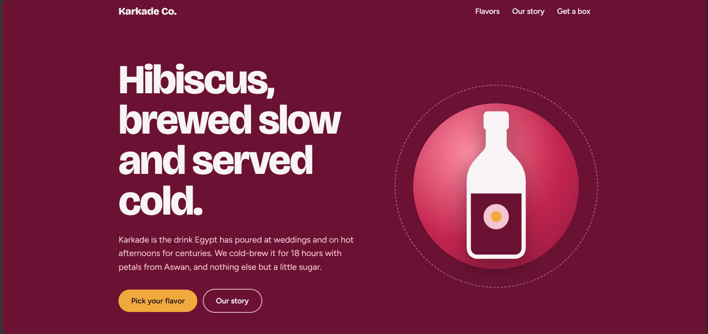

# Karkade Co. – Landing Page

A responsive landing page for a fictional cold-brewed hibiscus drink brand. Built as a design and front-end sample.

**Live demo:** https://nadinefahmy.github.io/karkade-landing-page/

## What's inside

- Hero section, flavor cards, brand story, testimonials, and an email sign-up
- Fully responsive (desktop, tablet, mobile)
- Keyboard-friendly focus states and reduced-motion support
- Small vanilla JS for the "Add to box" button and email validation
- Single file, no frameworks, no build step

## Tech

HTML5, CSS3 (custom properties, grid, flexbox), vanilla JavaScript, Google Fonts.

## Run locally

Download `index.html` and open it in any browser.

## Note

Karkade Co. is a made-up brand. Nothing on this page is a real product, and the forms don't send any data.
